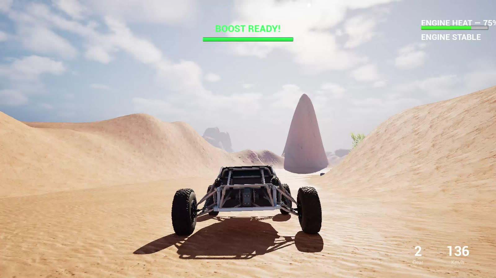
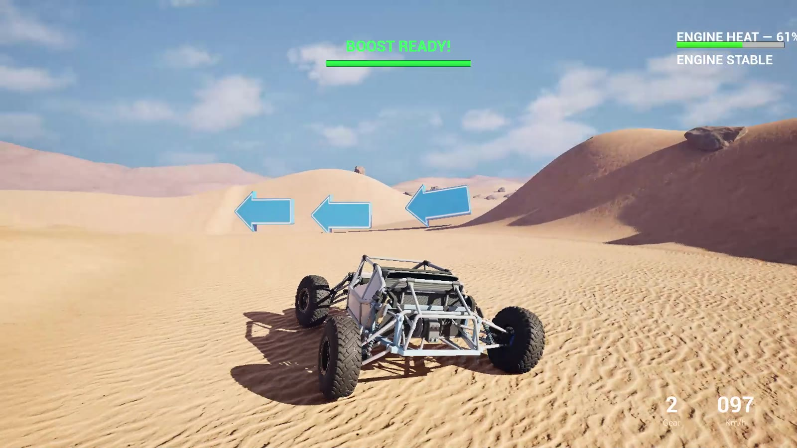
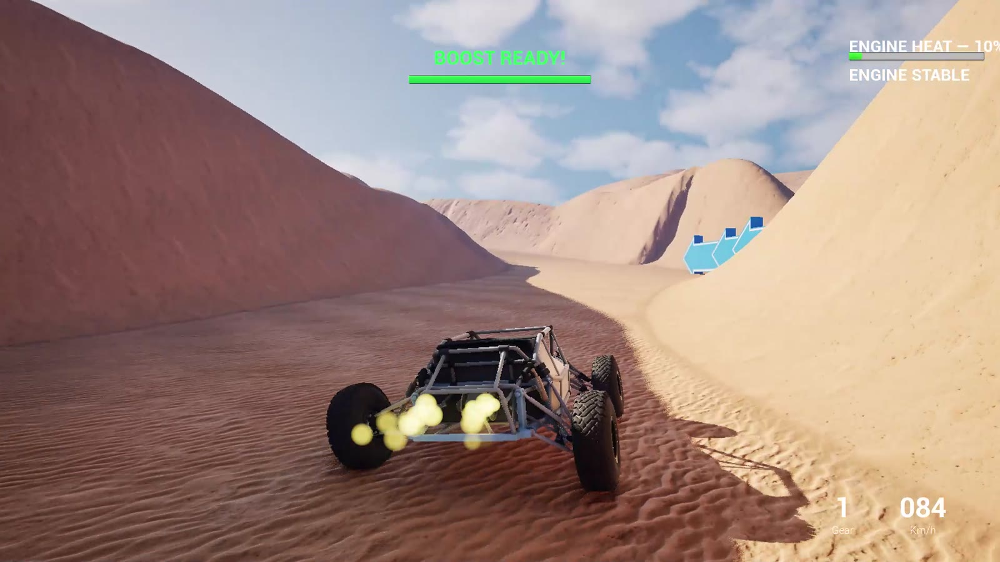
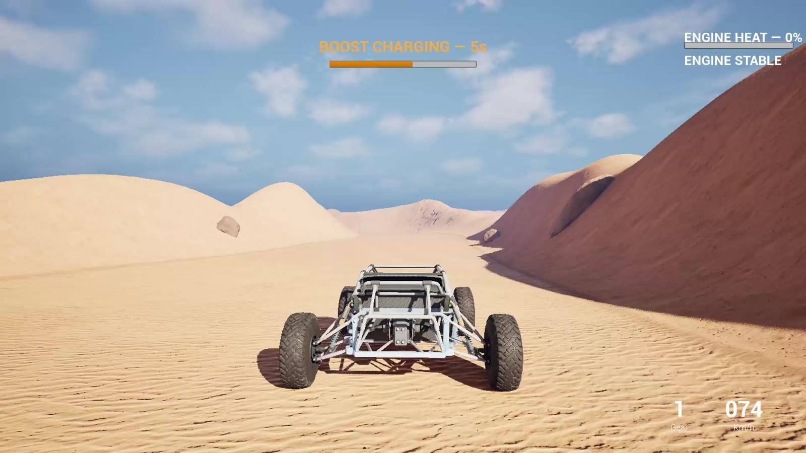
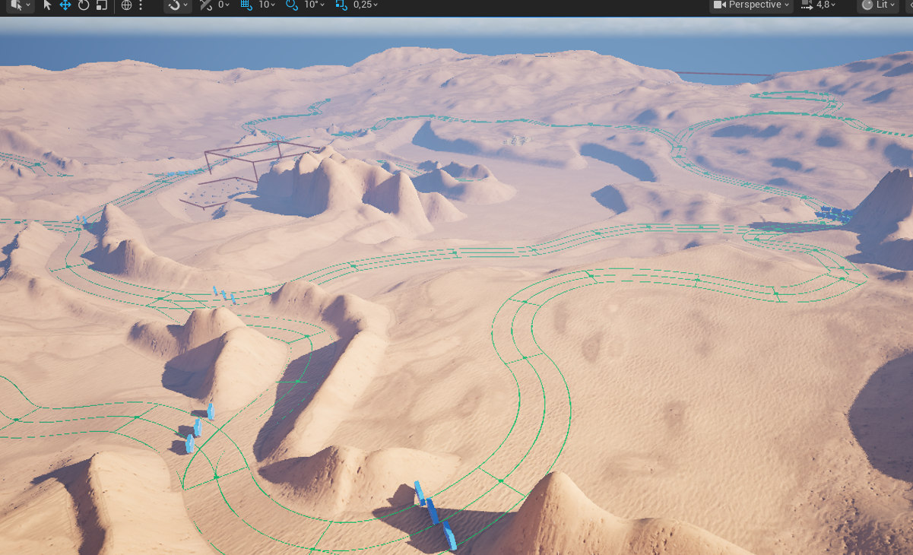
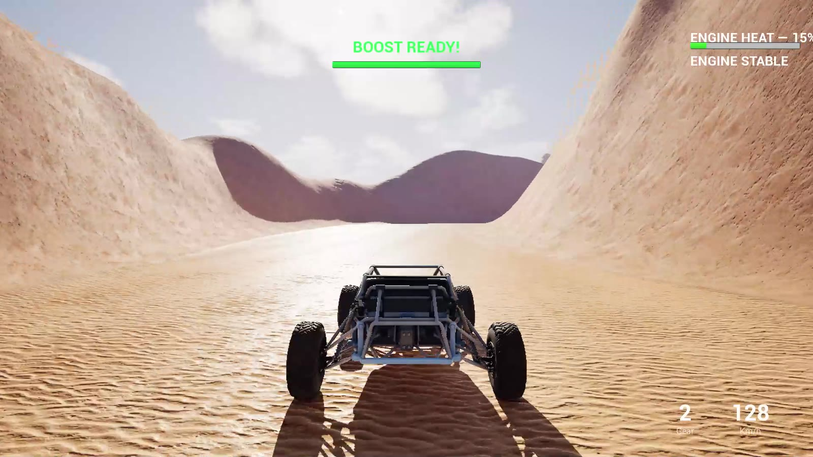
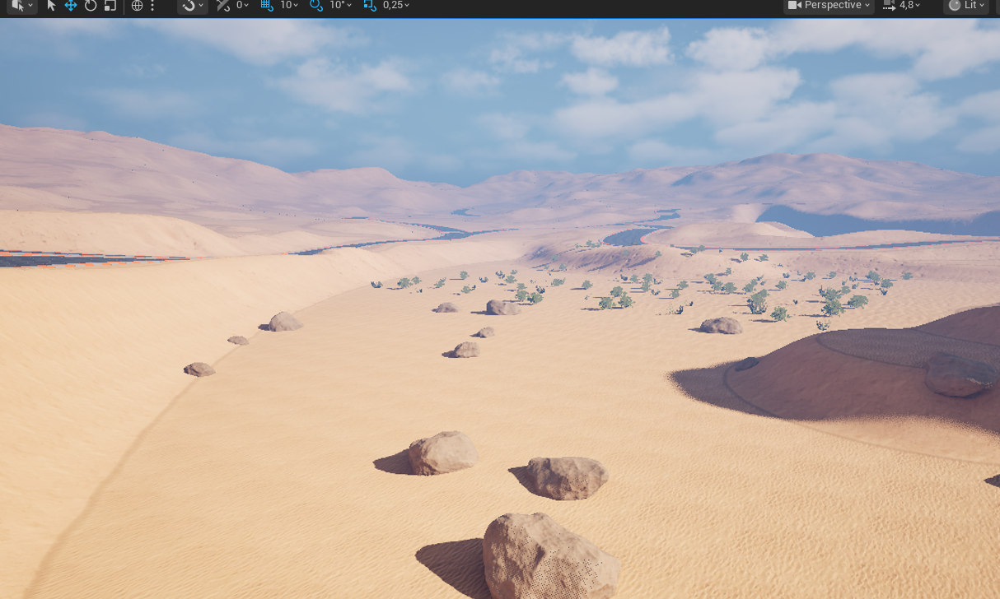
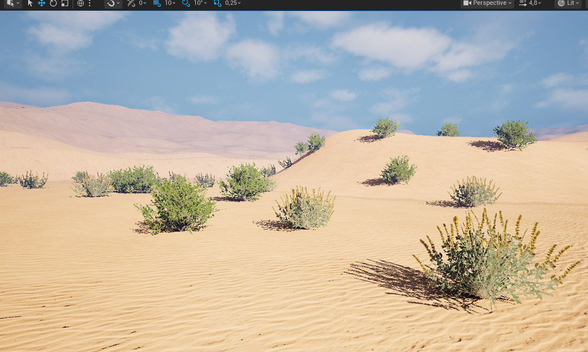
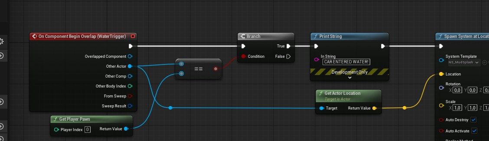

# Velocity Rivals 🏎️

### Unreal Engine 5 · Off-Road Driving Prototype · Blueprints / PCG / Niagara

**Portfolio build: v0.1** · **Status: Work in progress** · **Mode: Free driving**



> A playable off-road vehicle prototype set in a hand-sculpted desert environment, created to practice Blueprint gameplay, terrain design, procedural content generation and Niagara visual effects.

## 🎬 Gameplay — 71-second highlight reel

[](media/VelocityRivals_Gameplay_Demo_v01.mp4)

**▶ [Watch the gameplay demo (MP4)](media/VelocityRivals_Gameplay_Demo_v01.mp4)**

*Real footage from the playable prototype. The edited video is silent. It demonstrates driving, the environment and in-game UI; it does not demonstrate a completed race or clearly show the mud splash interaction.*

## ⚡ At a glance

| Category | Implemented in v0.1 |
| --- | --- |
| Genre | Off-road free-driving technical prototype |
| Vehicle | Playable buggy, keyboard input, on-screen control UI |
| HUD | Speed / gear, boost charge, engine temperature / overheat feedback |
| Level | Sculpted desert terrain, off-road routes, Landscape Splines |
| Navigation | Reusable 3D directional arrow markers |
| Environment | PCG vegetation and rock scattering with variable scale and rotation |
| VFX | Blueprint-triggered Niagara water / mud splash interaction |
| Scope | **No checkpoints, laps or completed race mode yet** |

## 🎮 Vehicle gameplay and route guidance

Explore the sandy track, rocky desert and dunes. The vehicle interface displays speed, gear and boost / temperature feedback. I adjusted terrain obstacles and their scale after playtesting to preserve visibility from the third-person camera.


*Directional markers guide the player through the off-road route.*


*Boost and engine feedback on the gameplay HUD.*


*Playable buggy from the third-person camera.*

## 🏜️ Environment development

### 1. Terrain sculpting and route design

I used **Landscape sculpting, smoothing and Landscape Splines** to create drivable terrain and design a natural-looking sand route. Level elevation and route visibility were adjusted during testing.


*Terrain and course layout in Unreal Editor.*


*Reusable navigation markers and their placement.*


*The environment from the vehicle's camera.*

### 2. Procedural rocks and vegetation (PCG)

The PCG setup uses **Get Landscape Data → Surface Sampler → Transform Points → Static Mesh Spawner**, including density adjustments and randomized scale and rotation.


*PCG rock placement.*


*PCG vegetation placement.*

### 3. Niagara water / mud interaction

A reusable **`BP_MudPuddle`** Actor has a water-surface mesh and a **`WaterTrigger`** overlap volume. Blueprint checks the overlapping player Pawn and spawns the **`NS_MudSplash`** Niagara effect.


*Implementation in Blueprint; the effect is not clearly shown in the gameplay reel.*

## 🛠️ Technical stack

**Unreal Engine 5** · **Blueprint Visual Scripting** · **Landscape / Splines** · **PCG** · **Niagara** · **UMG** · **Fab asset integration**

## 👨‍💻 My contributions

- Assembled and iterated on the playable off-road driving prototype and Blueprint interactions.
- Sculpted desert terrain and designed the routes.
- Configured PCG Graphs to generate rocks and vegetation with variation.
- Created a reusable water / mud overlap-triggered Niagara interaction.
- Placed route markers and refined obstacles after testing.
- Integrated external art from Fab. **I did not create the third-party 3D models or textures.**

## 🧭 Project status and roadmap

This is **v0.1, a technical prototype rather than a finished game**. Planned additions include checkpoints, laps, race completion, collision/boundary refinements, improved driving surface response, sound, polish and performance profiling. These features are **not yet presented as implemented**.

## 📂 Repository structure

```text
VelocityRivals-Portfolio/
├── README.md
├── screenshots/
│   ├── 00-gameplay-hero.jpg
│   ├── 01-offroad-circuit.jpg
│   ├── 02-procedural-rocks.jpg
│   ├── 03-desert-vegetation.jpg
│   ├── 04-niagara-mud-trigger.jpg
│   ├── 05-directional-arrows-editor.jpg
│   ├── 06-gameplay-route-arrows.jpg
│   ├── 07-gameplay-canyon.jpg
│   ├── 08-gameplay-boost.jpg
│   └── 09-gameplay-vehicle.jpg
├── media/
│   └── VelocityRivals_Gameplay_Demo_v01.mp4
└── docs/
    ├── README.md
    ├── ASSET_CREDITS.md
    ├── CV_PORTFOLIO_TEXT.md
    ├── GITHUB_UPLOAD_PT.md
    └── VIDEO_EDIT_NOTES.md
```

**Further information:** [Documentation](docs/README.md) · [Asset and licensing notes](docs/ASSET_CREDITS.md) · [CV text](docs/CV_PORTFOLIO_TEXT.md)

This is a **public portfolio showcase**, not the full Unreal Engine source project or a downloadable playable build. Importable third-party assets are intentionally excluded.

---

*Independent learning and portfolio project. Unreal Engine is an Epic Games product. Not affiliated with or endorsed by Epic Games or MotorStorm.*
